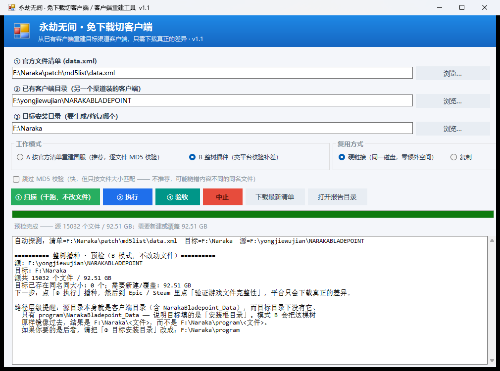

# 永劫无间 · 免下载切客户端

> 用你已经下载过的客户端文件，重建另一个渠道的客户端 —— 90 GB 的游戏，真正需要下载的只有几百 MB。

[](https://github.com/worldconfig/naraka-client-switcher/blob/main/docs/release-notes-v1.1.md)
[](https://github.com/worldconfig/naraka-client-switcher)
[](https://github.com/worldconfig/naraka-client-switcher/raw/main/dist/NarakaClientSwitcher.exe)
[](https://github.com/worldconfig/naraka-client-switcher)



---

## 下载

### ⬇️ [**点此直接下载 NarakaClientSwitcher.exe**](https://github.com/worldconfig/naraka-client-switcher/raw/main/dist/NarakaClientSwitcher.exe)（63.5 KB）

| 方式 | 链接 | 说明 |
|---|---|---|
| **直接下载**（推荐） | [`dist/NarakaClientSwitcher.exe`](https://github.com/worldconfig/naraka-client-switcher/raw/main/dist/NarakaClientSwitcher.exe) | 点开即下载，无需登录，链接长期有效 |
| 文件页面 | [点这里](https://github.com/worldconfig/naraka-client-switcher/blob/main/dist/NarakaClientSwitcher.exe) | 先看文件信息，再点右上角 Download |
| 历史版本 / 打包 zip | [Releases](https://github.com/worldconfig/naraka-client-switcher/releases) 页面 | 发布新版本时会附带打包好的 zip |

**完整性核对**：`dist/NarakaClientSwitcher.exe` 的 SHA256 为
`3784028410B7FAE0905554378C759CA28AD132841512D6CE0698475B7D16F890`（可用 `certutil -hashfile NarakaClientSwitcher.exe SHA256` 自查）。
该 exe 与仓库源码同源，可用 [`src/build.cmd`](src/build.cmd) 自行构建比对。

> 想发微信 / QQ 更方便：把下载到的 exe 与 [`docs/使用说明.txt`](docs/使用说明.txt) 一起打成一个 zip 发给对方即可。

---

## 这是什么

《永劫无间》在网易国服 / Steam / Epic 等渠道各自要占约 **90 GB**，但它们的文件其实 **99.6% 完全相同**。

本工具读取**目标渠道的官方文件清单**（每个文件的 MD5 与大小），把你本机已经下载过的相同文件
用**硬链接**复用过去（同一磁盘零额外空间），只从官方 CDN 下载真正缺失或校验不一致的那几百 MB。

**实测数据**（重建一份完整国服客户端：90.26 GB / 14984 个文件）：

| 项目 | 数值 |
|---|---|
| 硬链接复用（零下载） | 14941 个文件 / 89.88 GB |
| 真实网络下载 | **43 个文件 / 385.7 MB** |
| 磁盘实际多占 | **约 0.4 GB** |
| 全量 MD5 校验耗时 | 约 7 分钟（NVMe/SSD 更快） |

---

## 功能

| 功能 | 说明 |
|---|---|
| **A 模式 · 按官方清单重建** | 读取 `data.xml` 官方清单，逐文件 **MD5 校验**后复用，只下载差集。最严格，适合把别的渠道的客户端"变"成国服 |
| **B 模式 · 整树播种** | 不需要清单，把已有客户端整棵树链接/复制到目标目录，再交给 Epic / Steam 自带的"验证游戏文件完整性"补差 |
| **硬链接 / 复制** | 硬链接：同盘零额外空间、瞬间完成；复制：多占约 90 GB，但两份数据完全独立 |
| **一键下载官方清单** | 从网易官方地址拉取最新 `data.xml` |
| **三步流程** | ① 扫描（干跑，只读不写）→ ② 执行 → ③ 验收 |
| **实时进度** | 显示当前阶段、已完成/总数、百分比 |
| **报告与回滚** | 每次运行生成 `plan.csv` / `download.csv` / `failures.txt`，以及 `rollback.cmd`（双击即可撤销）与 `rollback.ps1` |
| **安全拦截** | 跨磁盘硬链接、源=目标、扫描后改路径等误操作会被明确拦下 |
| **免责声明** | 首次运行强制阅读并同意，之后可在界面内随时复查 |

---

## 快速开始

1. [**点此下载 `NarakaClientSwitcher.exe`**](https://github.com/worldconfig/naraka-client-switcher/raw/main/dist/NarakaClientSwitcher.exe)（63.5 KB）
   —— Windows 10 / 11 自带 .NET Framework 4.8，**无需安装任何运行库**
2. 双击运行；首次会弹出《免责声明与使用须知》，点"我已知悉并同意"继续
3. 依次操作：**① 扫描（干跑）** → 看清数字 → **② 执行** → **③ 验收**

> 详细图文说明见 [`docs/使用说明.txt`](docs/使用说明.txt)

### 使用前提

- 本机已经装过**任意一个渠道**能正常游玩的《永劫无间》（这是"免下载"的前提）
- 硬链接要求源目录与目标目录在**同一个磁盘分区**；不在同一分区请改用"复制"

---

## 两种工作模式

**A 模式：按官方清单重建（推荐）**

```
源：D:\EpicGames\NARAKABLADEPOINT   ← 已装好的 Epic/国际服客户端
清单：D:\Naraka\patch\md5list\data.xml  ← 网易官方清单（可一键下载）
目标：D:\Naraka                          ← 要重建的国服安装根目录
```

工具会：读取清单 → 逐文件 MD5 与源比对 → 一致就建硬链接，不一致/缺失才从官方 CDN 下载。

**B 模式：整树播种**

把已有客户端整棵文件树"镜像"到目标目录，然后到 Epic / Steam 里点
"验证游戏文件完整性"，平台只会补下真正的差异。

> 注意：B 模式是**原样镜像**。如果你的源是客户端目录（内含 `NarakaBladepoint_Data`），
> 目标也要填"装文件的那一层"（例如 `D:\Naraka\program`，而不是 `D:\Naraka`）。
> 工具会自动识别这种层级错误并给出提醒。

---

## 工作原理

```
官方清单 data.xml ──┐
                    ├─► 逐文件比对（大小 + MD5）
已有客户端目录 ──────┘        │
                              ├─ 内容一致 ──► 硬链接（零下载、零额外空间）
                              └─ 缺失/不一致 ─► 从官方 CDN 下载（并再次校验 MD5）
```

官方 CDN 下载地址规则：`<CDNDomain>/<TargetVersion>/<文件相对路径>`，
其中 CDN 域名与版本号都直接取自官方清单文件，不写死在程序里。

---

## 免责声明

> 完整声明在软件**首次运行时展示**，勾选同意后方可使用；界面内可随时复查。

- 本工具为**第三方个人工具**，与网易、24 Entertainment、《永劫无间》官方、Steam、Epic Games
  及其关联方**均无任何关系**，也未获得其授权、认可或支持。
- 本工具只做两件事：**复用你本机已下载过的相同文件**，以及**从官方 CDN 下载官方清单中的文件**；
  全程**不修改、不注入、不破解**任何游戏内容，也不改动反作弊组件本身。
- 你应当在拥有该游戏**合法授权**的前提下使用本工具，并自行确认使用方式符合游戏与平台的服务条款。
- **硬链接风险**：两份客户端共用同一批物理数据。若某平台更新时是"原地改写"而非"删除后重建"，
  可能同时影响另一份。请在任意一边更新游戏后重新运行一次「③ 验收」。
- 本工具按**"现状"**提供，不附带任何明示或暗示的担保。因使用本工具造成的游戏文件损坏、
  更新或启动失败、数据丢失、账号异常、封禁及其他任何直接或间接损失，**均由使用者自行承担**，
  作者不承担任何责任。
- 建议操作前自行备份重要数据。工具会在 `reports` 目录生成回滚脚本供你撤销本次创建的文件。

---

## 命令行模式

适合批处理或脚本调用（`--cli` 模式不弹免责声明）：

```bat
:: 干跑：只统计，不改任何文件
NarakaClientSwitcher.exe --cli --manifest <data.xml> --source <源目录> --target <目标目录>

:: 执行（复用已验证的扫描报告，可跳过重新计算 MD5）
NarakaClientSwitcher.exe --cli --manifest <data.xml> --target <目标目录> --plan <plan.csv> --execute

:: 验收
NarakaClientSwitcher.exe --cli --manifest <data.xml> --target <目标目录> --verify

:: B 模式整树播种
NarakaClientSwitcher.exe --cli --mode B --source <源目录> --target <目标目录> [--way copy]
```

其他参数：`--skip-hash`（**不推荐**，只按大小匹配）、`--way hardlink|copy`、`--help`。

退出码：`0` 成功 / `1` 有失败项 / `2` 参数或路径错误。

---

## 从源码构建

源码是**单文件 C# WinForms**，不需要 Visual Studio，也不需要 .NET SDK ——
Windows 自带的 .NET Framework 编译器即可构建：

```bat
:: 双击运行（或命令行执行）
src\build.cmd
```

手动编译的完整命令：

```bat
%WINDIR%\Microsoft.NET\Framework64\v4.0.30319\csc.exe ^
  /nologo /target:winexe /platform:anycpu /optimize+ /codepage:65001 ^
  /win32icon:src\app.ico ^
  /out:dist\NarakaClientSwitcher.exe ^
  /r:System.dll /r:System.Core.dll /r:System.Drawing.dll /r:System.Windows.Forms.dll /r:System.Xml.dll ^
  src\Program.cs
```

---

## 目录结构

```
.
├── dist/
│   └── NarakaClientSwitcher.exe     # 编译好的成品（Win10/11 免安装）
├── src/
│   ├── Program.cs                   # 全部源码（单文件）
│   ├── app.ico                      # 图标
│   └── build.cmd                    # 一键构建
├── docs/
│   ├── 使用说明.txt                  # 给普通用户的图文说明
│   ├── screenshot.png               # 界面截图
│   └── release-notes-v1.1.md        # Release 说明（文件名与标签对应）
├── tools/
│   ├── Rebuild-NarakaCN.ps1         # PowerShell 参考实现（A 模式，与 C# 版结果一致）
│   └── Verify-NarakaCN.ps1          # PowerShell 版验收脚本
└── README.md
```

`tools/` 里的 PowerShell 脚本是最早的实现，也是 C# 版本的**交叉验证基准**：
两者在同一份数据上给出的分类结果完全一致（14941 复用 / 43 下载）。

---

## 常见问题

**Q：提示"需要下载"几十 GB？**
A：说明源目录选错了，或两者差异确实很大。正常应该是几百 MB。

**Q：找不到 `data.xml`？**
A：点界面上的"下载最新清单"，工具会从 `update.yjwujian.cn` 拉取官方清单。

**Q：提示"源和目标重复"或"跨盘无法硬链接"？**
A：源不能位于目标内部；硬链接不能跨分区，改用"复制"。

**Q：更新游戏之后需要注意什么？**
A：重新运行一次「③ 验收」。若某文件两侧不一致，从没坏的那一边重新复用一次即可。

**Q：Windows 提示"未知发布者"？**
A：程序未做数字签名，属正常现象。点「更多信息 → 仍要运行」。

**Q：验收通过就一定能进游戏吗？**
A：验收只保证**文件与官方清单完全一致**，能否登录/启动取决于游戏与账号本身。
建议首次进游戏前先跑一次平台自带的修复/校验。
